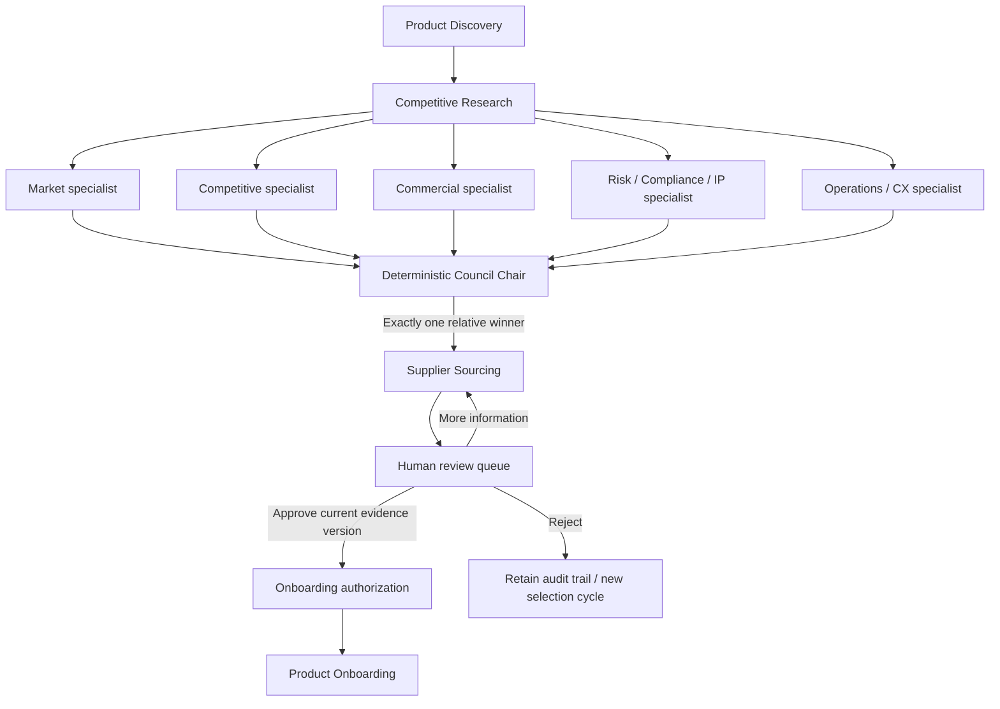
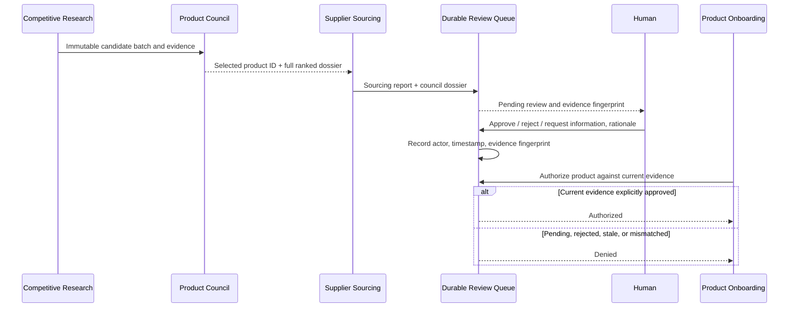

# Product Council to onboarding: implementation architecture

This document complements [the approved decision contract](product-council-sourcing-approval.md) and [the implementation roadmap](../agents/ROADMAP.md).

## End-to-end sequence

No specialist vetoes or approves a candidate. Selection is not a compliance clearance, commercial guarantee, or onboarding authorization. The Chair must select one winner from every valid nonempty researched batch, even if all candidates are poor.

## Evidence and decision boundary

## Integration boundaries

1. **Specialist research adapter**: produce the five complete, cited assessments expected by `council.py`. No fabricated evidence, supplier claims or vetoes.
2. **Supplier adapter**: take the selected product ID and full dossier. Validate exact SKU and supplier identity, landed cost, MOQ, quality, compliance documents, and lead time. Record verified/unverified/blocked status with provenance. An alternative SKU must be a separate proposal, not a silent replacement.
3. **Review persistence**: store the full immutable sourcing handoff and an append-only decision history. Approval is bound to a SHA-256 fingerprint of the handoff. Changing evidence invalidates earlier approval.
4. **Onboarding adapter**: require authorization immediately before any externally visible onboarding action, not merely when a workflow starts. Reject pending, rejected, stale or mismatched decisions.

## Operational controls

- Authenticate human reviewers in the host application; do not treat a user-supplied actor string as proof of identity.
- Enforce role-based access, transaction isolation, audit retention, and secret management at the host boundary.
- Keep the council score and absolute opportunity caveats visible alongside risks and dissent.
- Never treat unavailable supplier credentials or blocked verification as a successful sourcing outcome.
- Validate duplicate submissions and replay behavior before production rollout.
