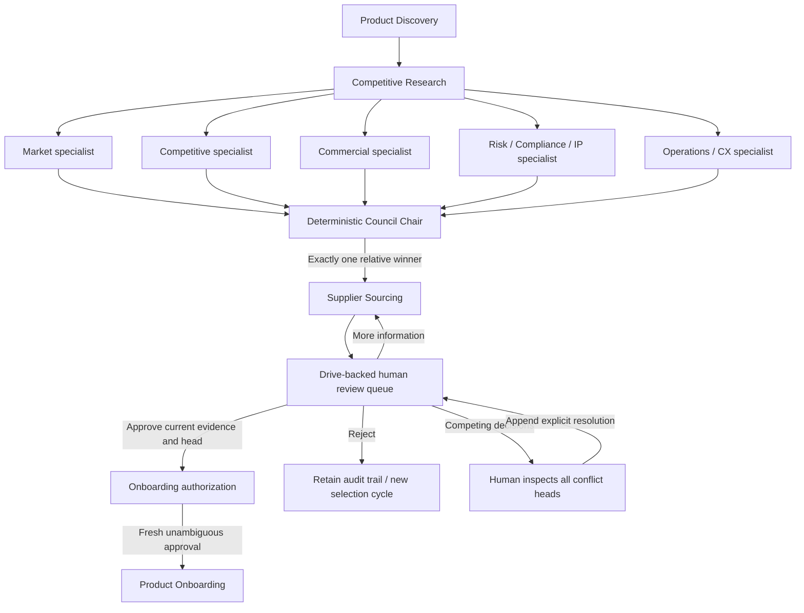
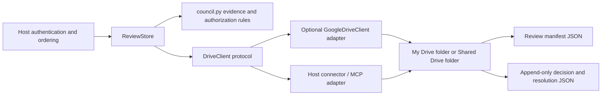

# Product Council to onboarding: implementation architecture

This document complements [the approved decision contract](product-council-sourcing-approval.md), [Drive persistence](product-council-drive-persistence.md) and [the implementation roadmap](../agents/ROADMAP.md).

## End-to-end sequence



No specialist vetoes or approves a candidate. Selection is not a compliance clearance, commercial guarantee, or onboarding authorization. The Chair must select one winner from every valid nonempty researched batch, even if all candidates are poor.

## Evidence and decision boundary

```mermaid
sequenceDiagram
  participant S as Supplier Sourcing
  participant Q as ReviewStore
  participant D as DriveClient / Drive folder
  participant H as Authenticated Human
  participant O as Product Onboarding
  S->>Q: Selected product and complete sourcing dossier
  Q->>D: Create immutable JSON manifest
  Q-->>H: Dossier, evidence version, current decision head
  H->>Q: Human action, rationale, displayed version and head
  Q->>D: List all pages and verify JSON / causal history
  alt Displayed head is current
    Q->>D: Append content-addressed decision event
    Q->>D: Re-read and check for visible conflicts
  else Stale or competing heads
    Q-->>H: Conflict; reload and inspect all decisions
    H->>Q: Fresh decision acknowledging exact conflict heads
    Q->>D: Append resolution; retain both branches
  end
  O->>Q: Authorize immediately before onboarding
  Q->>D: Fresh read and integrity / evidence / head checks
  alt Current evidence has one explicit approved head
    Q-->>O: Authorized
  else Pending, rejected, stale, conflicted or invalid
    Q-->>O: Denied
  end
```

## Persistence components



## Integration boundaries

1. **Specialist research adapter**: produce the five complete, cited assessments expected by `council.py`. No fabricated evidence, supplier claims or vetoes.
2. **Supplier adapter**: take the selected product ID and full dossier. Validate exact SKU and supplier identity, landed cost, MOQ, quality, compliance documents, and lead time. Record verified/unverified/blocked status with provenance. An alternative SKU must be a separate proposal, not a silent replacement.
3. **Review persistence**: store the full immutable sourcing handoff and append-only decision history in Drive. Approval is bound to a SHA-256 fingerprint of the handoff. Changing evidence invalidates earlier approval. A resolution explicitly joins all observed conflict heads without deleting events.
4. **Onboarding adapter**: require authorization immediately before any externally visible onboarding action, not merely when a workflow starts. Reject pending, rejected, stale, mismatched, conflicted or invalid records.

## Operational controls

- Authenticate human reviewers in the host application; do not treat a user-supplied actor string as proof of identity.
- Enforce role-based access, audit retention and secret management at the host boundary. Use a host coordinator for strict ordering across decision writes and onboarding; Drive has no SQLite-style transactional lock.
- Complete listings and fresh reads are required, but are not a transaction or a guarantee against unseen concurrent writes. An authorized Drive editor can still alter, hide or delete records.
- Keep the council score and absolute opportunity caveats visible alongside risks and dissent.
- Never treat unavailable supplier credentials or blocked verification as a successful sourcing outcome.
- Validate duplicate submissions, replay behavior, permissions and race recovery before production rollout.
